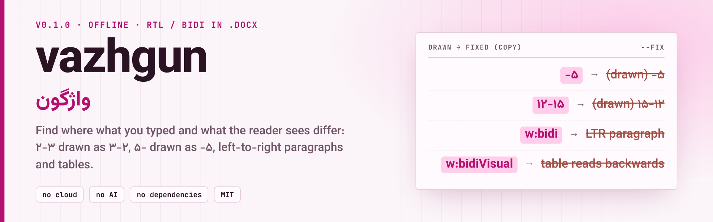
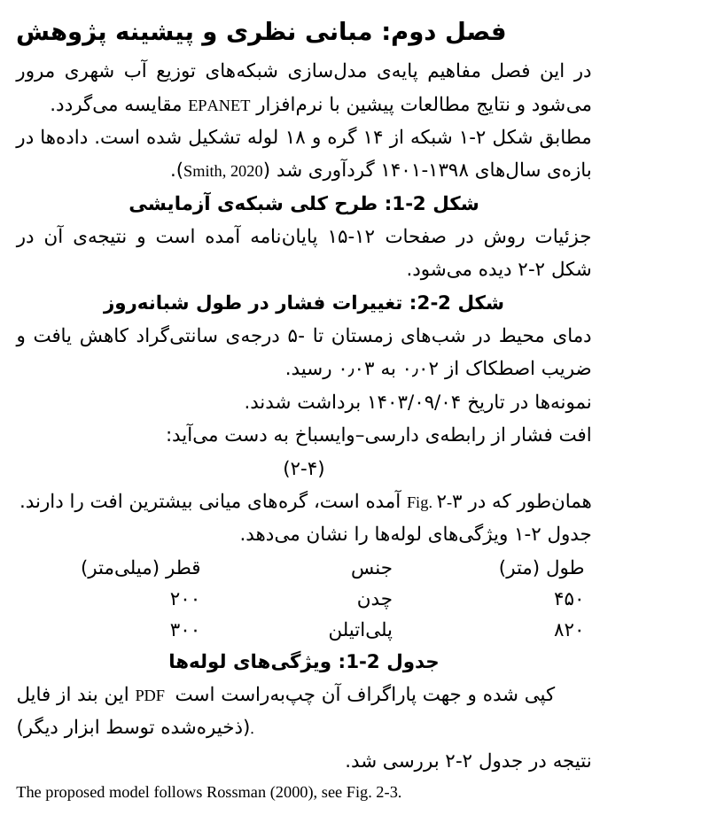
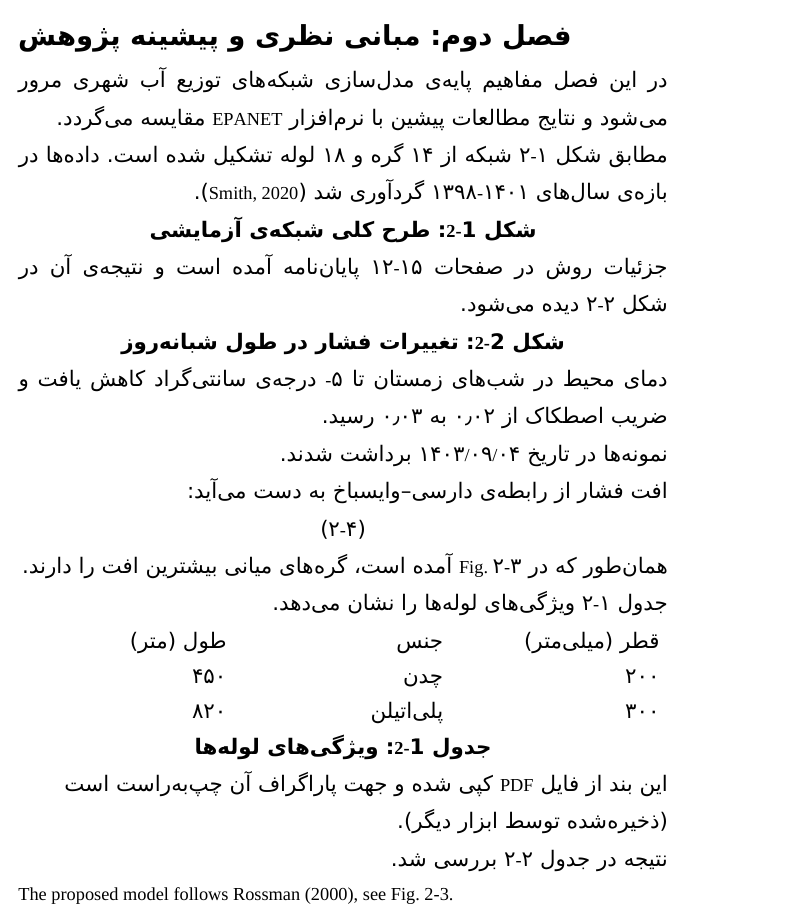

<div align="center">

<picture>
  <source media="(prefers-color-scheme: dark)" srcset="assets/banner-dark.png">
  
</picture>

<div dir="rtl">

[English](README.md) · **فارسی** · [🌐 وب‌سایت](https://mrzroot.github.io/vazhgun/) · [📦 انتشار نسخه‌ی ۰٫۱٫۰](https://github.com/mrzroot/vazhgun/releases/tag/v0.1.0) · [🗒 تغییرات](CHANGELOG.md)

</div>

     

</div>

<div dir="rtl">

> **vazhgun (واژگون)** یک `.docx` فارسی/عربی را باز می‌کند و جاهایی را فهرست می‌کند که *آنچه تایپ کرده‌اید* با *آنچه خواننده می‌بیند* فرق دارد: «شکل ۲-۳» که ۳-۲ کشیده می‌شود، منفی که پشت عدد می‌پرد، پاراگراف و جدول چپ‌به‌راست، نویسه‌های نامرئی جهت. آفلاین؛ `--fix` یک **نسخه‌ی کپی** صریح و اصلاح‌شده می‌نویسد.

**فهرست:** [چرا](#-چرا) · [نصب](#-نصب) · [شروع سریع](#-شروع-سریع) · [قبل و بعد](#-قبل-و-بعد) · [امکانات](#-امکانات) · [کدها](#-قاعده‌ها-و-کدهای-یافته) · [چگونه کار می‌کند](#-چگونه-کار-می‌کند) · [محدودیت‌ها و صداقت](#-محدودیت‌ها-و-صداقت) · [نقشه‌ی راه](#-نقشه‌ی-راه) · [مشارکت](#-مشارکت) · [مجوز](#-مجوز)

## 🎯 چرا

در الگوریتم دوجهتیِ یونیکد (UAX #9) خط‌تیره و اسلش بین رقم‌های فارسی نویسه‌ی «ضعیف» هستند؛ بنابراین جهتِ رسم یک زنجیره‌ی عددی به اطرافش بستگی دارد: بعد از حروف فارسی، `۲-۳` به ترتیب خواندن کشیده می‌شود (عدد اول سمت راست)، اما اول خط، داخل پرانتز یا بعد از حروف لاتین چپ‌به‌راست است. پس پایان‌نامه‌ای که هم «شکل ۲-۳» و هم «(۲-۴)» و «Fig. ۲-۳» دارد، در یک صفحه دو ترتیب متفاوت نشان می‌دهد، و `-۵` ممکن است به شکل `۵-` دیده شود. هر کدام از این‌ها وقتی بدانید کجا هستند، اصلاحِ یک‌خطی دارند. `vazhgun` محل آن‌ها را پیدا می‌کند و ترتیب را به‌جای واگذاری به نمایش‌دهنده، صریح می‌کند.

## 📦 نصب

پایتون ۳٫۹ به بالا، بدون هیچ وابستگی. فقط روی لینوکس آزمایش شده است.

</div>

```sh
pipx install git+https://github.com/mrzroot/vazhgun      # هنوز روی PyPI منتشر نشده است
uvx --from git+https://github.com/mrzroot/vazhgun vazhgun --demo
pip install -e .                                        # از یک clone
```

<div dir="rtl">

## 🚀 شروع سریع

</div>

```sh
vazhgun thesis.docx                              # بررسی
vazhgun thesis.docx --json                       # خروجی ماشینی (شامل اجزای نمایش)
vazhgun thesis.docx --strict                     # با هشدار هم کد خروج ۱ می‌دهد (پیش‌فرض: فقط با خطا)
vazhgun thesis.docx --fix --chains ltr           # thesis.vazhgun.docx را می‌نویسد؛ عدد اول سمت چپ
vazhgun thesis.docx --fix --chains reading       # عدد اول سمت راست (ترتیب خواندن)
vazhgun thesis.docx --fix --strip-controls       # نویسه‌های جهتِ سرگردان را هم حذف می‌کند
vazhgun --demo                                   # یک فصل ساختگی می‌سازد و بررسی می‌کند
vazhgun --make-sample chapter2.docx              # فقط همان فایل نمونه را می‌نویسد
vazhgun notes.txt                                # .txt/.md: فقط بررسی در سطح پاراگراف
```

<div dir="rtl">

خروجی واقعی روی یک سند ساختگی (گزیده):

</div>

```text
$ vazhgun chapter2.docx            # a synthetic chapter generated by `vazhgun --demo`; excerpt
vazhgun 0.1.0 · chapter2.docx · 25 paragraphs (19 Persian), 1 tables

! V203 Sign «-» is drawn after its number   [¶7 · Normal]
    typed: ⁦در شب‌های زمستان تا -۵ درجه‌ی سان⁩
    drawn: ⁦⁧ درجه‌ی سان⁩⁦۵⁩⁧در شب‌های زمستان تا -⁩⁩   (approximate; runs listed left to right)
    why  : In a right-to-left paragraph a hyphen or plus in front of a digit is a weak character that goes with the Persian text around it, so it is d …
    fix  : Put a left-to-right mark (U+200E) before the sign, or use the real minus U+2212 with it. `--fix` inserts the mark.

! V202 Inconsistent drawing of caption / chapter-style numbers (شکل ۲-۳, (۲-۴))   [¶10 · Normal]
    typed: ⁦(۲-۴)⁩
    drawn: ⁦⁧)⁩⁦۲-۴⁩⁧(⁩⁩   (approximate; runs listed left to right)
    why  : 2 of these are drawn left-to-right (first number on the left) and 6 right-to-left (first number on the right) in this document, so the same …
    fix  : Pick one convention for the whole thesis and apply it: `--fix --chains reading` (first number on the right, RLM after the separator) or `--fix --chains ltr` (first number on the left).

[…]

2 error(s), 4 warning(s), 3 note(s); 9 fixable with --fix.
```

<div dir="rtl">

(خطوط فارسی با نشانه‌های نامرئیِ ایزوله پیچیده شده‌اند تا در هر ترمینالی یکسان چاپ شوند؛ در بخش «drawn» اجزای خط از چپ به راست فهرست شده‌اند. خروجی کامل و ویرایش‌نشده در [docs/demo.txt](docs/demo.txt) است. متن خروجی ابزار انگلیسی است.)

## 🆚 قبل و بعد

همان فصل ساختگی در LibreOffice 25.2 (لینوکس، فونت‌های جایگزین)، پیش از اجرای `vazhgun --fix --chains ltr --strip-controls` و پس از آن: بازه‌ی صفحه‌ی `۱۵-۱۲` به `۱۲-۱۵` تبدیل می‌شود، `۵-` به `-۵`، و پاراگراف چسبانده‌شده از PDF و جدول راست‌به‌چپ می‌شوند. این LibreOffice است، **نه Word**.

| قبل | بعد |
|---|---|
|  |  |

در خط فرمان همین یافته چنین است (خروجی واقعی، یک فایل `.txt` یک‌خطی و ساختگی): خط *typed* یعنی `تا -۵ درجه` با علامت پشت عدد *drawn* می‌شود و `--fix` پیش از علامت یک نشانه‌ی چپ‌به‌راست (LRM) می‌گذارد.

## 🧩 امکانات

| | |
|---|---|
| 🧭 **ممیزی جهت** | پاراگراف و جدول با متن فارسی و بدون تنظیم راست‌به‌چپ (`w:bidi` و `w:bidiVisual`)، از راه سبک‌ها هم |
| 👁 **تایپ‌شده در برابر کشیده‌شده** | نمای تقریبیِ «کشیده‌شده» برای هر خط، با پیاده‌سازی خودش از الگوریتم دوجهتی یونیکد (UAX #9) |
| 🔢 **زنجیره‌ی عددها** | شماره‌ی شکل، بازه‌ی صفحه و سال، تاریخ: گزارش می‌دهد وقتی یک سند یک نوع زنجیره را به دو ترتیب می‌کشد |
| 🛠 **اصلاح صریح در کپی** | `w:bidi` / `w:bidiVisual`، نشانه‌های LRM یا RLM (`--chains`)، حذف نویسه‌های کنترلی؛ بقیه‌ی بخش‌های فایل بایت‌به‌بایت یکسان می‌ماند |
| ⚖ **سنجیده با مرجع** | پیاده‌سازی با libfribidi (سطح‌های یکسان روی ۴۰٬۰۰۰ رشته‌ی تصادفی) و python-bidi (رشته‌های بدون پرانتز) مقایسه شده |
| 🔌 **اسکریپت و عامل‌ها** | `--json`، `--strict`، کد خروج، و یک snippet برای `AGENTS.md` |
| 🔒 **آفلاین** | بدون شبکه، بدون هوش مصنوعی، بدون تلمتری، بدون وابستگی |

## 🔎 قاعده‌ها و کدهای یافته

<details>
<summary><b>همه‌ی کدهای یافته (V101 تا V203)</b></summary>

| کد | شدت | معنی | `--fix` |
|---|---|---|---|
| V101 | خطا | متن فارسی در پاراگراف چپ‌به‌راست (بدون `w:bidi`، حتی از راه سبک) | `w:bidi` اضافه می‌کند |
| V102 | اطلاع | پاراگراف لاتین که راست‌به‌چپ شده است | خیر |
| V103 | هشدار | جدولِ دارای متن فارسی بدون `w:bidiVisual` (ستون‌ها وارونه خوانده می‌شوند) | `w:bidiVisual` اضافه می‌کند |
| V104 | خطا/اطلاع | نویسه‌های نامرئی embedding / override / isolate (نامتوازن = خطا) | `--strip-controls` |
| V201 | اطلاع | زنجیره‌ی عددی (بازه، تاریخ، شماره‌ی شکل) که ترتیبش به نمایش‌دهنده بستگی دارد؛ در این سند یکدست است | `--chains` |
| V202 | هشدار | یک نوع زنجیره‌ی عددی در یک سند به دو ترتیب کشیده می‌شود | `--chains` |
| V203 | هشدار | علامت `-` یا `+` پیش از رقم، بعد از عدد کشیده می‌شود (`-۵` شبیه `۵-` است) | یک LRM پیش از علامت |

</details>

## 🔧 چگونه کار می‌کند

۱. جهت پاراگراف و جدول از زنجیره‌ی سبک‌ها و `docDefaults` خوانده می‌شود؛ زنجیره‌ی عددها با عبارت باقاعده (رقم با `- – / .`) پیدا و به شماره‌ی شکل، بازه‌ی صفحه، بازه‌ی سال، بازه یا تاریخ دسته‌بندی می‌شود.
۲. خط «drawn» همان الگوریتم دوجهتی یونیکد است که اینجا پیاده شده (با libfribidi سنجیده شده)، به‌صورت runهایی از چپ به راست. تقریبی از آنچه یک نمایش‌دهنده می‌کشد است، نه آنچه Word می‌کشد.
۳. `--fix` کپی می‌نویسد؛ جزئیات در ادامه.

`--chains ltr` دور هر زنجیره علامت چپ‌به‌راست (U+200E) می‌گذارد؛ `--chains reading` بعد از هر جداکننده علامت راست‌به‌چپ (U+200F) می‌گذارد. ابزار فقط متنِ `<w:t>` و ویژگی‌های `w:bidi` و `w:bidiVisual` را ویرایش می‌کند؛ بقیه‌ی بخش‌های فایل بایت‌به‌بایت یکسان می‌مانند، و اگر تعداد پاراگراف‌ها با آنچه بررسی‌کننده دیده یکی نباشد، چیزی نمی‌نویسد.

## 🧭 محدودیت‌ها و صداقت

- **ممیزی است، نه حکم.** «drawn» تقریبی است؛ یک ترتیب درست یگانه وجود ندارد و اینکه دانشگاه شما کدام قرارداد را می‌خواهد تصمیمی سلیقه‌ای و با شماست.

- **ورد نیست.** «Drawn» همان الگوریتم دوجهتیِ یونیکد (UAX #9) است که در همین ابزار پیاده شده؛ ورد، LibreOffice، Google Docs و خروجی PDF ممکن است کمی فرق داشته باشند. پیاده‌سازی با libfribidi (سطح‌های embedding یکسان روی ۴۰٬۰۰۰ رشته‌ی تصادفی) و python-bidi (فقط رشته‌های بدون پرانتز؛ در جفت‌پرانتزها با استاندارد اختلاف دارد) سنجیده شده است. نمونه را فقط در LibreOffice 25.2 نمایش داده‌ام. هیچ‌کدام را در Microsoft Word روی ویندوز یا مک **راستی‌آزمایی نکرده‌ام**؛ یادداشتی از نویسنده‌ای دیگر گزارش می‌کند که ورد ممکن است تاریخِ اسلش‌دار را روز-اول نشان دهد، در حالی که الگوریتم چپ‌به‌راست می‌گوید، و فقط LRM آن را درست می‌کند. به همین دلیل V201 می‌گوید «به نمایش‌دهنده بستگی دارد» و نمی‌گوید «غلط است».
- یک ترتیبِ درستِ یگانه وجود ندارد. اینکه دانشگاه شما `۲-۳` می‌خواهد یا `۳-۲` یک تصمیم نگارشی است؛ `vazhgun` ناهماهنگی را گزارش می‌کند و انتخاب با شماست. `--chains ltr` (LRM) راهی است که بهتر مستند شده؛ `--chains reading` (RLM پس از جداکننده‌ها) از روی الگوریتم یونیکد استنتاج شده و کمتر آزموده شده است.
- روش‌های حدسی: زنجیره‌ها با عبارت باقاعده (رقم با `- – / .`) پیدا و به شکل، بازه‌ی صفحه، بازه‌ی سال، بازه یا تاریخ طبقه‌بندی می‌شوند؛ اعشار، ساعت و شناسه نادیده گرفته می‌شود. جعبه‌متن، پاورقی، سرصفحه و پای‌صفحه، نظرها، content controlها و فیلدهایی جز نتیجه‌ی ساده‌ی `SEQ` تحلیل نمی‌شوند. نویسه‌های صریح embedding/override گزارش می‌شوند (V104) ولی پیش‌نمایش داده نمی‌شوند.
- جهتی که از راه سبک‌ها (زنجیره‌ی `basedOn`) و `docDefaults` به ارث می‌رسد خوانده می‌شود؛ جهتی که فقط در سطحِ شماره‌گذاری تعیین شده باشد خوانده نمی‌شود. جعبه‌متن، متنِ حذف‌شده‌ی ردیابی‌شده، معادله، پاورقی و content control به‌عنوان «تحلیل‌نشده» شمرده و در گزارش یادآوری می‌شوند.
- اعتبارسنجِ رسمی دانشگاه نیست و حاشیه، فونت یا منابع را نمی‌سنجد.
- آفلاین: بدون شبکه، بدون هوش مصنوعی، بدون ارسال داده. فقط فایلی را که بدهید می‌خواند و فقط کپی‌ای را که بخواهید می‌نویسد.

## 🗺 نقشه‌ی راه

- [ ] راستی‌آزمایی رفتار در Word واقعی روی ویندوز و مک (تا اینجا فقط LibreOffice 25.2)
- [ ] پانویس، سرصفحه، کادر متن و جهت سطح شماره‌گذاری
- [ ] پیش‌نمایش کنترل‌های صریح embedding و override
- [ ] انتشار در PyPI

## 🤝 مشارکت

فقط کتابخانه‌ی استاندارد، پایتون ۳٫۹ باید کار کند، آزمون‌ها با فایل‌های `.docx` ساختگی و تولیدشده (هرگز پایان‌نامه‌ی واقعی). [CONTRIBUTING.md](CONTRIBUTING.md) را بخوانید؛ issue و pull request قالب دارند. ارجاع: [CITATION.cff](CITATION.cff).

</div>

```sh
git clone https://github.com/mrzroot/vazhgun && cd vazhgun
pip install -e ".[test]" && pytest
```

<div dir="rtl">

**برای عامل‌های هوش مصنوعی**

[docs/AGENTS.snippet.md](docs/AGENTS.snippet.md) را در `AGENTS.md` / `CLAUDE.md` / قوانین Cursor بگذارید تا دستیار پیش از ویرایش یک فایل ورد فارسی، جهت‌ها را بررسی کند.

## 📄 مجوز

MIT · محمدرضا زارع · [mrzroot](https://github.com/mrzroot)

</div>
